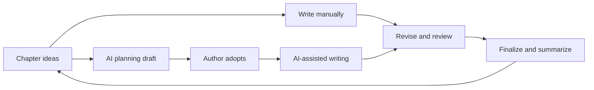

<p align="center">
  
</p>

<h1 align="center">Shizhang Writer</h1>

<p align="center">A Windows novel-writing app with local project files and optional AI assistance.</p>

<p align="center">
  
  
  <a href="LICENSE"></a>
</p>

<p align="center">
  <a href="README.md">中文</a> · English · <a href="https://github.com/Sophora-2325/ShizhangWriter/releases">Downloads &amp; releases</a> · <a href="#getting-started">Getting started</a> · <a href="https://github.com/Sophora-2325/ShizhangWriter/issues">Report an issue</a>
</p>

---

**Shizhang Writer** (拾章写作) keeps chapters, characters, plot threads and background material in one writing workspace. Write the prose yourself, or choose a model to help plan, draft and review it. AI planning produces a draft that you explicitly adopt before it is used for writing.

Projects live in folders on your PC. You choose the model provider. Cloud-model credits are not included, and third-party API calls may incur charges.

The current version is **1.0.0**. The launch file is `ShizhangWriter.exe`. Existing installer filenames, install locations, configuration and data folders retain `novel-gm` for compatibility.

## Getting started

### Windows installer

Visit [Releases](https://github.com/Sophora-2325/ShizhangWriter/releases) for published Windows x64 installers, named `novel-gm-setup-<version>.exe`. Available download versions depend on what has been uploaded there.

The installer includes the desktop client, backend and Python runtime. **You do not need to install Python, Node.js or the .NET SDK separately.** Windows 10 / 11 (x64) is required.

1. Install and launch the app, create a work, and choose its folder.
2. For AI assistance, open **Settings → AI models → Add model** and enter your provider details. You can also start by writing manually.
3. Write your chapter ideas, or generate a planning draft and explicitly adopt it.
4. Draft and revise the chapter, using review, version history and export as needed.

**Demo mode (no AI calls)** lets you try the workflow without a model. Dictation requires a separately prepared local speech model; its status appears in General settings.

### Run from source

For developers and users who want to modify the app. Install Git, the **.NET 8 SDK**, and Python 3.11+ (3.13 recommended).

```powershell
git clone https://github.com/Sophora-2325/Auto-Novel-Writer.git
cd Auto-Novel-Writer

py -3.13 -m venv .venv
.\.venv\Scripts\python.exe -m pip install -r services\core\requirements.txt

scripts\run-wpf.bat
```

The desktop client starts the local backend. Debugging from source and building a complete installer are separate paths; see [Development and packaging](#development-and-packaging) for the first bundled build.

## What you can do

| Task | Features |
|---|---|
| Concentrate on the prose | Free writing, focus mode, autosave and formatting tools |
| Plan with AI | Guided writing, planning drafts and questions, explicit adoption and proposal history |
| Manage a long story | Characters, plot threads, background entries, hard rules and inherited chapter settings |
| Guide the writing style | Sentence length, complete reference passages, forbidden phrases, expressions to avoid and suggested wording |
| Edit and review | Rich text, illustrations, find and replace, review sidebar, version history and checks |
| Export or back up | TXT / Markdown import, Markdown / EPUB / TXT / Word export, ZIP backups and platform publishing packs |
| Adjust the workspace | Chinese, English and Japanese UI; light/dark themes; three accents; paper/full width; token usage and cost estimates |

**Free writing and Guided writing are workspace layouts.** Switching to Free writing does not disable the AI sidebar. Focus mode temporarily hides surrounding panels; the review sidebar provides a book-page view.

Export capabilities differ: TXT is plain text, Markdown retains some formatting semantics, and EPUB and Word support more layout information. **Illustrations are not currently embedded in these four export formats**; they remain in the project's `插图` folder.

## Writing a chapter



Planning, prose, review notes and audits can open in separate windows. Summary extraction after finalization may call the selected model; an extraction failure does not undo the saved finalized state. Editing an earlier chapter marks affected memory and plans for review without rewriting later prose.

## Models and writing instructions

**Choose your model.** Use OpenAI, Anthropic Claude or Google Gemini, or OpenAI-compatible services such as DeepSeek, Kimi, Qwen, Zhipu GLM, Doubao and OpenRouter. Local Ollama, llama.cpp and other compatible endpoints are also supported. Each setup can select strong and fast models separately, and each work can follow the default or choose its own setup.

“Use local models only” restricts model calls; it does not disconnect the whole app. Searching for or importing writing instructions online can still contact the relevant website.

**Writing instructions (Skills).** Manage them under **Settings → Advanced → Writing instructions (Skills)**. Eleven built-in instruction packs are disabled by default, covering chapter structure, dialogue, hooks and scene-specific prose styles. Enabled packs are used according to their purpose and matching scene types.

<details>
<summary>Custom writing instruction example</summary>

An instruction pack is a `SKILL.md` file with front matter:

```markdown
---
name: Restrained narration
description: Express emotion through concrete action
applies_to: generate
scenes: action, suspense
source: Custom
---

Prefer observable actions to abstract summaries of emotion.
Keep dialogue consistent with the relationship and situation.
```

`applies_to` accepts `plan`, `generate` or `both`. Leave `scenes` empty to apply to every chapter. You can also import from a link or ask a model to distill writing material. Manually edited built-in copies are preserved during updates.

</details>

Plugins also appear under Advanced. They currently support registration and management only; **plugin code is not executed**. Writing instructions are not automatically learned personalization.

## Projects, keys and data

- **One folder per work.** Prose, characters, settings, plans and summaries travel with the work and can be backed up or moved together.
- **Keys are stored separately.** API keys and the optional GitHub token use Windows Credential Manager. The UI shows only the ending characters. Environment variables are also supported.
- **Cloud models receive relevant content.** Planning, drafting, extraction and audits send the material needed for that request to your configured service.
- **You publish the manuscript.** Publishing tools prepare files and open a site's author desk. They do not store site accounts, sign in or submit on your behalf.

| Content | Default location |
|---|---|
| Work files | The folder chosen when creating the work |
| Index, writing instructions, plugins and backend log | `%LOCALAPPDATA%\novel-gm\storage\` |
| Window layout | `%LOCALAPPDATA%\novel-gm\layout.json` |
| Language and appearance | `%APPDATA%\novel-gm\ui.json` |

```text
<work name>\
  作品.json          Characters, threads, background and style
  第1章.md           Chapter prose
  插图\              Illustrations
  人物画像\          Character portraits
  导出\              Exports, backups and publishing packs
  .novel-gm\         Plans, review notes, summaries, snapshots and history
```

See [Saving and chapter memory](docs/MEMORY_AND_SAVES.md) in Chinese for recovery and retrieval details. Keep periodic ZIP backups of your work.

## Development and packaging

The desktop app uses .NET 8 WPF, with a local FastAPI backend. The browser interface is for development; Node.js 18+ is needed only for that interface.

```powershell
scripts\run-wpf.bat          # Desktop and backend development
scripts\dev.bat              # Optional browser debugging UI
scripts\stop.bat             # Stop browser development services

# First complete installer: requires Python 3.13 and Inno Setup 6
scripts\build-installer.bat

# Publish the complete Release and create a desktop shortcut
scripts\install-desktop-shortcut.bat

# Update the complete Release later
scripts\publish-wpf.bat
```

In a source workspace, the fixed Release entry is **`..\AppVersions\novel-gm\ShizhangWriter.exe`**, including the backend and embedded Python. The installer uses the folder selected during installation.

Choose tests that directly cover the change, for example:

```powershell
.\.venv\Scripts\python.exe -m pytest services\core\tests\test_bible_style_paths.py -q
dotnet test apps\desktop-tests\NovelGm.Desktop.Tests.csproj --filter "FullyQualifiedName~LoreMiscLayoutTests"
```

<details>
<summary>Source layout and common environment variables</summary>

```text
apps/desktop-wpf/     Windows desktop client
apps/web/             Browser debugging UI
apps/desktop/         Earlier Tauri shell
services/core/        Local FastAPI backend
prompts/              Planning, drafting, extraction and audit prompts
scripts/              Development, publishing and shortcut scripts
installer/            Inno Setup configuration
docs/                 Usage boundaries and design/development notes
```

| Variable | Purpose |
|---|---|
| `NOVEL_GM_ROOT` | Code root containing `services/core` |
| `NOVEL_GM_DATA` | Backend data directory |
| `NOVEL_GM_PORT` | Backend port, `18765` by default |
| `OPENAI_API_KEY` and others | Model keys supplied through the environment |
| `GITHUB_TOKEN` | Optional GitHub token for skill discovery |

</details>

## More documentation

[Desktop client](docs/DESKTOP_WPF.md) · [Windows](docs/WINDOWS.md) · [Stack](docs/STACK.md) · [UI baseline](docs/UI_BASELINE.md) · [AI planning](docs/PLAN_MODE_A.md) · [About](ABOUT.md)

## License

This project uses **[CC BY-NC 4.0](LICENSE)**. You may study, copy, modify and share it for non-commercial purposes under the license terms, with attribution and an indication of changes. Commercial use is not granted. Contact the author on GitHub for commercial licensing.

Cloud-model services and API credits are not included; their costs and terms come from your chosen provider.
