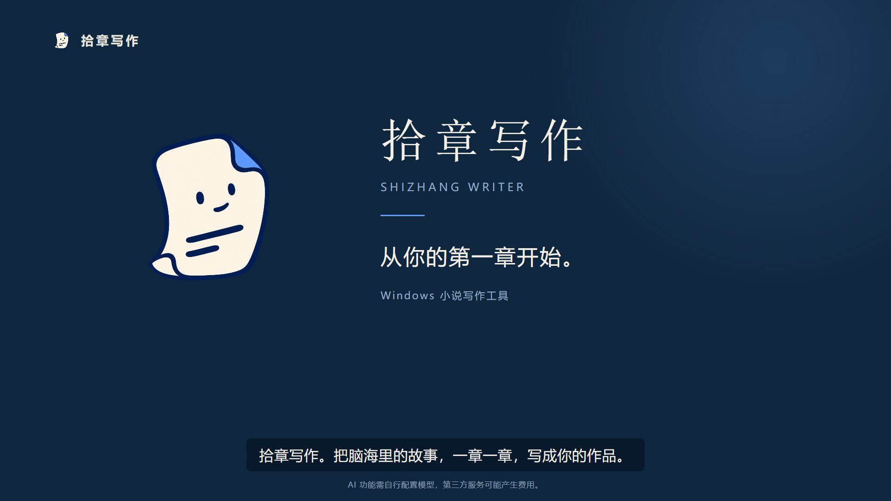

<p align="center">
  
</p>

<h1 align="center">拾章写作 · Shizhang Writer</h1>

<p align="center"><strong>把脑海里的故事，一章一章，写成你的作品。</strong></p>
<p align="center">本地保存作品的 Windows 小说写作工具，支持自由写作与自选模型的 AI 辅助创作。</p>

<p align="center">
  
  
  <a href="LICENSE"></a>
</p>

<p align="center">
  中文 · <a href="README.en.md">English</a> · <a href="https://github.com/Sophora-2325/Auto-Novel-Writer/releases">下载安装包</a> · <a href="#快速开始">快速开始</a> · <a href="https://github.com/Sophora-2325/Auto-Novel-Writer/issues">反馈问题</a>
</p>

---

**拾章写作**为逐章创作小说的作者提供一个工作台：整理人物与设定，推敲章节走向，编写、修改和审阅正文，再导出或备份作品。

你可以从头手写，也可以让自己选择的模型参与规划、起草、续写和检查。**AI 规划先形成草稿，由作者确认采用；故事怎么发展，仍由你决定。**

## 60 秒认识拾章写作

[](docs-media/promo/shizhang-writer-60s.mp4)

 **[▶ 播放或下载宣传片](docs-media/promo/shizhang-writer-60s.mp4)**


## 为什么使用拾章写作

- **让长篇设定有处安放。**章节、人物、脉络、背景和写作偏好集中管理，减少在不同文档之间来回查找。
- **按自己的方式写。**自由写作与分步创作提供不同的工作布局，专注写作可以临时收起周边面板。
- **让 AI 参与具体环节。**需要时再请模型协助规划、起草或审阅，查看规划草稿、补充答案，再确认采用。
- **自己选择模型和作品位置。**作品按文件夹保存在本机，可以配置云端服务或本地兼容模型服务。

软件不附带云端模型额度。使用第三方 API 可能产生费用；使用云端模型时，当次所需的正文与设定会发送给你配置的服务。

## 主要功能

| 创作环节 | 可以做什么 |
|---|---|
| 章节写作 | 自由写作、分步创作、专注写作、自动保存、正文格式调整 |
| AI 规划 | 生成规划草稿、回答待决问题、确认采用、查看方案历史 |
| 长篇设定 | 管理人物、脉络、背景条目和硬规则，按章继承设定 |
| 章节节奏 | 使用叠条约束安排人物、脉络与戏份的参与区间及描写侧重 |
| 文风偏好 | 设置句长、完整文风参考片段、禁写词句、避免表达和替代建议 |
| 修改与检查 | 富文本编辑、插图、查找替换、评注、正文版本记录与相关检查 |
| 阅读与整理 | 使用审阅侧栏查看书页效果，按需将规划、正文、评注或审校弹出为独立窗口 |
| 导入与导出 | 导入 TXT / Markdown，导出 Markdown / EPUB / TXT / Word，制作作品 ZIP 备份和平台发布包 |
| 工作台外观 | 中文、英文、日文界面，浅色与深色主题，三种强调色及正文宽度选择 |
| 用量查看 | 查看用量气泡和费用估算，按自己的习惯调整工作台 |

**自由写作与分步创作是工作布局，不是 AI 开关。**切换到自由写作后，仍可以按需使用 AI。

文风偏好用于后续生成和相关检查，不会自动改写已有正文。插图保存在作品的「插图」目录中，**目前不会嵌入上述四种导出文件**；TXT、Markdown、EPUB 和 Word 对排版的保留能力也不同。

## 快速开始

### 下载安装

系统要求：**Windows 10 / 11，x64。**

前往 [Releases 页面](https://github.com/Sophora-2325/Auto-Novel-Writer/releases) 选择 Windows 安装包，可下载版本以页面实际附件为准。安装后启动 **Shizhang Writer**，程序入口为 `ShizhangWriter.exe`。

完整安装包包含桌面客户端、后端与 Python 运行环境，**使用安装包不需要另装 Python、Node.js 或 .NET SDK**。

### 写下第一章

1. **新建作品。**填写作品名称，选择保存文件夹。可以先留空背景和文风参考，直接开始写作。
2. **整理必要设定。**按需添加人物、脉络和背景，或先在规划区记下本章想法。
3. **选择创作方式。**自己编写正文；需要 AI 时，进入 **设置 → AI 模型 → 添加模型**，配置服务地址、密钥和模型。
4. **查看并采用规划。**生成 AI 规划后，先阅读草稿、补充待决问题，确认采用后再用于辅助写作。
5. **修改、定稿与导出。**检查正文，按需使用审阅、版本记录、作品备份和导出。

想先熟悉操作，可以选择 **「演示模式（不调用 AI）」**。语音听写需要另行准备本地语音模型，安装状态可在通用设置中查看。

## 和 AI 一起写一章

一章可以从自己的正文开始，也可以从规划开始：

```text
本章想法 ──→ 自己写正文 ──────────────────┐
    │                                     ↓
    └──→ AI 规划草稿 → 作者确认采用 → AI 辅助写作
                                          ↓
                                      修改与审阅
                                          ↓
                                      定稿与摘要
                                          ↓
                                        下一章
```

- **草稿与采用稿分开。**回答规划问题不等于采用草稿；重新规划期间，原来的采用稿仍保留。
- **作者约束由作者维护。**叠条约束用于表达本章人物、脉络和戏份的安排，AI 读取这些约束，不代替作者改写它们。
- **定稿后可以提取摘要。**提取会调用当前模型，可能产生费用；失败不会撤销已保存的定稿状态，可以重试。
- **早章改稿会提示复核。**相关记忆和后续计划会标记为需要复核，后续正文保留，不会被自动改写。

规划与记忆的具体行为见 [AI 规划方案](docs/PLAN_MODE_A.md)、[叠条约束](docs/STACKED_CONSTRAINTS_UI.md) 和 [正文保存与章节记忆](docs/MEMORY_AND_SAVES.md)。

## 模型与写作指令

### 自选模型

应用提供 OpenAI、Anthropic Claude、Google Gemini、DeepSeek、通义千问、智谱 GLM、豆包、OpenRouter 等服务的配置入口，也可使用自定义 OpenAI 兼容接口，连接 Ollama、llama.cpp 等本地服务。

每条配置可以分别设置强模型与快模型，作品可以跟随默认配置，也可以单独选择。服务是否可用、模型名称和费用以你实际配置的服务为准。

**「仅使用本地模型」限制模型调用，不代表整个应用断网。**在线搜索或通过链接导入写作指令等操作仍可能访问对应网站。

### 写作指令（Skills）

在 **设置 → 高级 → 写作指令（Skills）** 中管理。内置 11 个指令包，默认停用，涵盖章节框架、自然对白、章末钩子、叙述顺序及不同戏份的文风。启用后，指令按用途和戏份参与规划或正文生成。

你可以自行编辑指令，也可以通过链接导入或由模型提炼写作材料。写作指令用于明确生成要求，不是自动个性化记忆。

<details>
<summary>自定义写作指令示例</summary>

一个指令包由带文件头的 `SKILL.md` 构成：

```markdown
---
name: 克制的叙述
description: 用具体动作表达情绪
applies_to: generate
scenes: action, suspense
source: 自定义
---

优先写可观察到的动作，少用抽象的情绪总结。
让对白符合人物关系和当下处境。
```

`applies_to` 可填 `plan`、`generate` 或 `both`；`scenes` 留空时适用于所有章节。内置指令被手动修改后，更新时会保留作者的版本。

高级设置中的插件入口目前用于登记插件和管理启用状态，**不执行插件代码**。

</details>

## 作品与数据

### 一部作品，一个文件夹

作品保存在新建时选择的位置。正文、人物、设定、计划和摘要随作品保存，可以整体备份，或移动文件夹后重新打开。

```text
<作品名>\
  作品.json          人物、脉络、背景与文风
  第1章.md           章节正文
  插图\              正文插图
  人物画像\          人物头像
  导出\              导出文稿、备份与平台发布包
  .novel-gm\         章节计划、评注、摘要、快照与历史
```

建议定期制作作品 ZIP 备份。自动保存、版本记录和恢复的适用范围见 [正文保存与章节记忆](docs/MEMORY_AND_SAVES.md)。

### 密钥与内容去向

| 内容 | 保存或使用方式 |
|---|---|
| 作品文件 | 保存在作者选择的作品文件夹中 |
| API 密钥与可选 GitHub 令牌 | 单独存于 Windows 凭据管理器，界面仅显示末尾部分；也支持通过环境变量提供 |
| 云端模型请求 | 将当次所需的正文、设定等材料发送给作者配置的服务 |
| 平台发布包 | 整理文稿和发布信息，并打开作家后台；不保存平台账号，不代替作者登录或提交 |

默认桌面数据位置：

| 内容 | 位置 |
|---|---|
| 索引、写作指令、插件与后端日志 | `%LOCALAPPDATA%\novel-gm\storage\` |
| 窗口布局 | `%LOCALAPPDATA%\novel-gm\layout.json` |
| 语言与外观 | `%APPDATA%\novel-gm\ui.json` |

中文名称为「拾章写作」，英文名称为 **Shizhang Writer**。内部标识、配置及数据目录继续使用 `novel-gm`，保持与已有作品和安装配置兼容。

## 当前版本

当前源码版本为 **0.3.21**，详见 [版本说明](docs/RELEASE_0.3.21.md)。

- 中文与英文品牌名称统一，启动程序使用 `ShizhangWriter.exe`。
- 「杂项」页按文风偏好、内容与用词约束组织，支持总览和就地编辑。
- 文风参考按完整片段编辑；句长、规则摘要与保存状态更便于查看。

## 从源码运行

需要 Git、**.NET 8 SDK** 和 Python 3.11+，推荐 Python 3.13。以下命令使用 Python 3.13：

```powershell
git clone https://github.com/Sophora-2325/Auto-Novel-Writer.git
cd Auto-Novel-Writer

py -3.13 -m venv .venv
.\.venv\Scripts\python.exe -m pip install -r services\core\requirements.txt

scripts\run-wpf.bat
```

桌面客户端会自动启动本机 FastAPI 后端。桌面端使用 **.NET 8 WPF**；浏览器界面供开发调试使用，只有使用该界面时才需要 Node.js 18+。

### 开发与打包

| 操作 | 命令 |
|---|---|
| 运行 WPF 桌面端 | `scripts\run-wpf.bat` |
| 运行可选浏览器调试界面 | `scripts\dev.bat` |
| 停止浏览器开发服务 | `scripts\stop.bat` |
| 构建完整安装包 | `scripts\build-installer.bat` |
| 发布到固定正式版目录 | `scripts\publish-wpf.bat` |
| 发布并创建桌面快捷方式 | `scripts\install-desktop-shortcut.bat` |

首次完整打包需要 Python 3.13 和 Inno Setup 6。当前打包脚本输出 `dist/installer/ShizhangWriter-Setup-<版本>.exe`。

源码工作区的固定正式版入口为 `../AppVersions/novel-gm/ShizhangWriter.exe`，包含自包含客户端、后端和内嵌 Python。调试构建与完整发布是两条独立路径，`bin/`、`obj/` 和 `dist/` 中的中间产物不作为日常入口。

<details>
<summary>开发目录与环境变量</summary>

```text
apps/desktop-wpf/     Windows 桌面客户端
apps/web/             浏览器调试界面
apps/desktop/         早期 Tauri 外壳
services/core/        本地 FastAPI 后端
prompts/              规划、生成、提取和审校提示词
scripts/              开发、发布与快捷方式脚本
installer/            Windows 安装包构建
docs/                 使用说明与设计开发文档
docs-media/           品牌、界面与宣传视频素材
```

| 变量 | 用途 |
|---|---|
| `NOVEL_GM_ROOT` | 包含 `services/core` 的代码根目录 |
| `NOVEL_GM_DATA` | 直接运行后端时的数据目录；桌面启动器使用其默认桌面数据位置 |
| `NOVEL_GM_PORT` | 后端端口，默认 `18765` |
| `OPENAI_API_KEY` 等 | 通过环境变量提供相应服务的密钥 |
| `GITHUB_TOKEN` | 搜索写作指令时使用的可选 GitHub 令牌 |

</details>

## 文档与反馈

[Windows 使用说明](docs/WINDOWS.md) · [桌面端说明](docs/DESKTOP_WPF.md) · [技术栈](docs/STACK.md) · [界面基线](docs/UI_BASELINE.md) · [项目简介](ABOUT.md)

遇到问题或希望提出建议，请在 [Issues](https://github.com/Sophora-2325/Auto-Novel-Writer/issues) 中说明操作步骤、应用版本与预期行为；提供截图或日志前，请隐去密钥及不希望公开的作品内容。

## 许可

本项目采用 **[CC BY-NC 4.0](LICENSE)**：允许按许可条款学习、复制、修改和非商业分享，需署名并注明修改；商业使用需要另行授权，请通过 GitHub 联系作者。

模型服务由作者自行选择，软件不附带云端模型服务或 API 额度。
